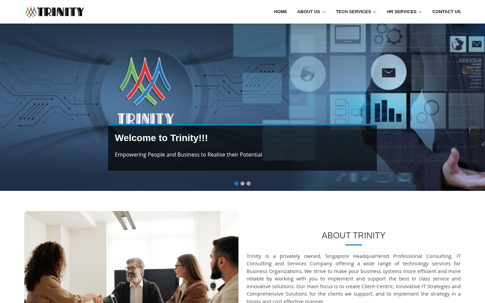
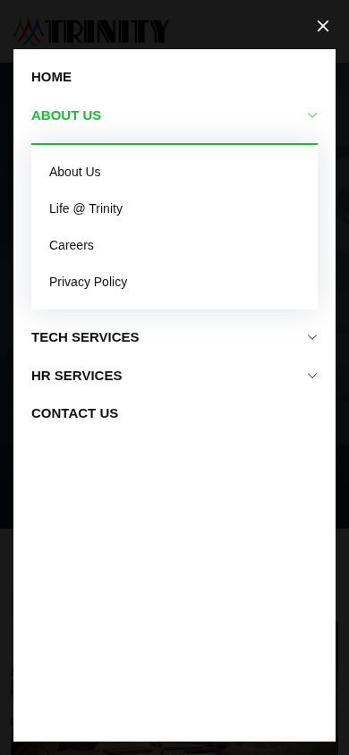
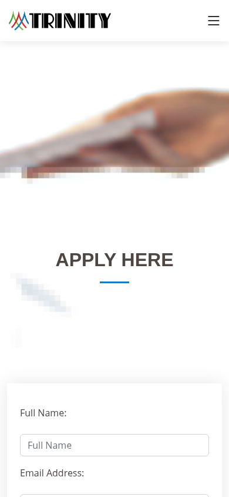

# Checkpoint 1 — Trinity reference-site inventory

**Status: findings complete for approval; checkpoint 2 has not started.**

Reference: https://www.trinityconsulting.asia/
Repository: `ericwangAISavy/twinlink`
Inspection: November 4, 2026 (America/Chicago; capture runtime November 5 UTC).
Baseline: `3557d5a169ca2a7672a2c1de4705f4885596ab59`.

## Scope and method

Inspected the live public site in installed Chromium through Playwright: desktop **1440 × 900**, mobile **390 × 844** with touch/mobile emulation. Discovered pages from the header, homepage cards, footers and service sidebars, then inspected all 15 distinct content routes at both sizes. Also checked six linked `.php` variants. This is the reachable public-page inventory, not a server-side enumeration of hidden URLs.

Saved viewport screenshots plus full-page screenshots after scrolling to trigger reveal animations. The initial unscrolled full-home capture had unrevealed sections and was rejected; it is not part of the evidence. Accepted captures and extracted live DOM data are in [evidence](evidence/). Browser tools were not exposed, so installed Chromium supplied the captures. No production content, applications or messages were sent. Empty-submit checks blocked all POST requests.

**Environment limitations:** the configured allowlist blocks `fonts.googleapis.com`, `ajax.googleapis.com` and `www.google.com`. Fonts can fall back; Google Maps embeds do not load; jQuery-dependent handlers raise `$ is not defined`. These are observations in this environment, not proof that the public site fails for unrestricted visitors. No dependencies were replaced or injected.

## Inspection steps and health

1. **Landing and navigation — usable, with accessibility risks.** Desktop dropdown hover opens About; mobile menu opens and About expands; Careers navigation reaches `/carrer`. Hero indicator 3 displays “Our Service”; the three-slide carousel declares a 5-second interval. Screens: [desktop dropdown](evidence/16-desktop-about-menu.png), [mobile menu](evidence/17-mobile-menu-open.png), [About expanded](evidence/18-mobile-about-expanded.png), [carousel](evidence/20-mobile-carousel-third.png).
2. **Company and policy pages — content available.** About, Life @ Trinity and Privacy Policy render at both sizes. Mobile image banners consume much of the first screen; policy requires a long scroll. See page evidence 02, 03 and 05 below.
3. **Technology and HR discovery — technology content available; HR links misleading.** All eight technology destinations render. HR dropdown/footer links are placeholders, while four homepage HR cards reach unrelated Infrastructure/ERP content. See pages 07–15 and [expanded mobile HR menu](evidence/21-mobile-hr-expanded.png).
4. **Careers and contact — fields available; end-to-end delivery unverified.** Careers has general CV intake rather than searchable vacancies. Contact has office cards, maps and feedback. Empty clicks produce no usable validation in this restricted environment; POST was blocked. See [Careers via mobile menu](evidence/19-mobile-careers-via-menu.png), [contact empty check](evidence/23-desktop-contact-empty.png), [careers empty check](evidence/24-desktop-careers-empty.png).
5. **Footer and return navigation — available; placeholders remain.** Footer has page/service lists, Singapore and India details, tel/mailto and social links. Back-to-top returns to `scrollY = 0` after smooth scrolling settles. [Mobile footer](evidence/22-mobile-footer.png). External social destinations and email/phone apps were not opened.

## Representative evidence

Desktop navigation:

Mobile navigation and application entry:

The route table links every desktop/mobile viewport and full-page capture.

## Page inventory

Every route below returned HTTP 200 on desktop and mobile. Exact source spellings are preserved, including `/carrer` and ampersands.

| # | Page and route | Content / purpose | Health | Screens |
| --- | --- | --- | --- | --- |
| 01 | **Home** `/` | Three-slide hero; company introduction; 8 technology cards; 8 HR cards; values; job-search/resources/CV prompts. | Links need correction | [Desktop](evidence/01-home-desktop.png) · [Mobile](evidence/01-home-mobile.png) · [Desktop full](evidence/01-home-desktop-full.png) · [Mobile full](evidence/01-home-mobile-full.png) |
| 02 | **About Trinity** `/about` | Skyline banner; company introduction; Mission, Vision and Goal image cards (not tabs). | Content available | [Desktop](evidence/02-about-desktop.png) · [Mobile](evidence/02-about-mobile.png) · [Desktop full](evidence/02-about-desktop-full.png) · [Mobile full](evidence/02-about-mobile-full.png) |
| 03 | **Life @ Trinity** `/life-at-trinity` | Work-life-balance content, workplace imagery, Apply Here and email links. | Content available | [Desktop](evidence/03-life-at-trinity-desktop.png) · [Mobile](evidence/03-life-at-trinity-mobile.png) · [Desktop full](evidence/03-life-at-trinity-desktop-full.png) · [Mobile full](evidence/03-life-at-trinity-mobile-full.png) |
| 04 | **Careers / Apply Here** `/carrer` | General CV intake, not a job listing: full name, email, contact number, CV file, message, SEND. | Submission unverified | [Desktop](evidence/04-carrer-desktop.png) · [Mobile](evidence/04-carrer-mobile.png) · [Desktop full](evidence/04-carrer-desktop-full.png) · [Mobile full](evidence/04-carrer-mobile-full.png) |
| 05 | **Privacy Policy** `/privacy-policy` | Long policy covering collection, purposes, sharing, preferences, security and data-subject rights. | Readable; long mobile scroll | [Desktop](evidence/05-privacy-policy-desktop.png) · [Mobile](evidence/05-privacy-policy-mobile.png) · [Desktop full](evidence/05-privacy-policy-desktop-full.png) · [Mobile full](evidence/05-privacy-policy-mobile-full.png) |
| 06 | **Contact** `/contact` | Singapore, Malaysia, Chennai and Coimbatore office details; four Google Maps embeds; feedback fields. | Maps blocked; submission unverified | [Desktop](evidence/06-contact-desktop.png) · [Mobile](evidence/06-contact-mobile.png) · [Desktop full](evidence/06-contact-desktop-full.png) · [Mobile full](evidence/06-contact-mobile-full.png) |
| 07 | **Digital Strategy & Transformation** `/digitalstrategy&transformation` | Blue wave title banner; explanatory content and image; Other Services sidebar. | Content available | [Desktop](evidence/07-digitalstrategyandtransformation-desktop.png) · [Mobile](evidence/07-digitalstrategyandtransformation-mobile.png) · [Desktop full](evidence/07-digitalstrategyandtransformation-desktop-full.png) · [Mobile full](evidence/07-digitalstrategyandtransformation-mobile-full.png) |
| 08 | **Managed Application** `/managed-application` | Shared service template with application-management content. | Content available | [Desktop](evidence/08-managed-application-desktop.png) · [Mobile](evidence/08-managed-application-mobile.png) · [Desktop full](evidence/08-managed-application-desktop-full.png) · [Mobile full](evidence/08-managed-application-mobile-full.png) |
| 09 | **Cloud Services Solutions** `/cloud-services-solutions-singapore` | Shared service template with cloud-services content. | Content available | [Desktop](evidence/09-cloud-services-solutions-singapore-desktop.png) · [Mobile](evidence/09-cloud-services-solutions-singapore-mobile.png) · [Desktop full](evidence/09-cloud-services-solutions-singapore-desktop-full.png) · [Mobile full](evidence/09-cloud-services-solutions-singapore-mobile-full.png) |
| 10 | **Enterprise Services** `/enterprise-services` | Shared service template with enterprise-services content. | Content available | [Desktop](evidence/10-enterprise-services-desktop.png) · [Mobile](evidence/10-enterprise-services-mobile.png) · [Desktop full](evidence/10-enterprise-services-desktop-full.png) · [Mobile full](evidence/10-enterprise-services-mobile-full.png) |
| 11 | **SAP Services** `/sap-services` | Shared service template with SAP content. | Content available | [Desktop](evidence/11-sap-services-desktop.png) · [Mobile](evidence/11-sap-services-mobile.png) · [Desktop full](evidence/11-sap-services-desktop-full.png) · [Mobile full](evidence/11-sap-services-mobile-full.png) |
| 12 | **Infrastructure Services** `/it-software-solutions` | Shared service template; legacy path is it-software-solutions. | Content available | [Desktop](evidence/12-it-software-solutions-desktop.png) · [Mobile](evidence/12-it-software-solutions-mobile.png) · [Desktop full](evidence/12-it-software-solutions-desktop-full.png) · [Mobile full](evidence/12-it-software-solutions-mobile-full.png) |
| 13 | **Cybersecurity & Risk** `/cyber-security` | Shared service template with cybersecurity/risk content. | Content available | [Desktop](evidence/13-cyber-security-desktop.png) · [Mobile](evidence/13-cyber-security-mobile.png) · [Desktop full](evidence/13-cyber-security-desktop-full.png) · [Mobile full](evidence/13-cyber-security-mobile-full.png) |
| 14 | **Big Data & Analytics** `/big-data-&-Analytics` | Shared service template; mixed-case URL and ampersand preserved. | Content available | [Desktop](evidence/14-big-data-and-Analytics-desktop.png) · [Mobile](evidence/14-big-data-and-Analytics-mobile.png) · [Desktop full](evidence/14-big-data-and-Analytics-desktop-full.png) · [Mobile full](evidence/14-big-data-and-Analytics-mobile-full.png) |
| 15 | **ERP Software** `/erp` | Legacy image-banner page and Service Category sidebar; reached from HR Staffing/Payroll cards. | Misleading inbound links | [Desktop](evidence/15-erp-desktop.png) · [Mobile](evidence/15-erp-mobile.png) · [Desktop full](evidence/15-erp-desktop-full.png) · [Mobile full](evidence/15-erp-mobile-full.png) |

### Linked PHP variants

`/carrer.php`, `/cloud-services-solutions-singapore.php`, `/cyber-security.php`, `/big-data-&-Analytics.php`, `/sap-services.php`, `/it-software-solutions.php` also return 200 and remain at their `.php` URL with corresponding page headings. These are additional reachable URL variants, not six additional distinct content pages. Checked response/headings only; not separately visually audited. See [extra checks](evidence/extra-checks.json).

## Interaction inventory

| Surface | Observed behavior / target | Verification and limits |
| --- | --- | --- |
| Fixed header | Logo is `#`; Home is `/`; About, Tech and HR are dropdown parents; Contact links to `/contact` | Desktop About hover and mobile About expansion exercised. Header persists while scrolling. |
| Mobile navigation | Hamburger opens a near-full-screen white menu over dark overlay; dropdown reveals nested links | About and HR expanded; Careers link navigated. Toggle is an icon element, not a named semantic button. |
| Hero carousel | Welcome, Our Solutions, Our Service; three dot indicators; source interval 5000 ms | Third indicator exercised and active text recorded. No visible pause control. |
| Technology cards | Eight named services link to the matching technology routes | Destination pages visited at both sizes. |
| HR dropdown/footer | All eight items use `#` | Recruitment click stays on homepage with `/#`; no service detail. |
| HR homepage cards | Recruitment, Executive Recruitment, RPO and Managed Staffing → `#`; Retained Search and HR Consultancy → `/it-software-solutions`; Staffing and Payroll → `/erp` | Exact hrefs recorded in inventory; Infrastructure and ERP destinations inspected. |
| Homepage values / job prompts | Commitment, Integrity, Service Excellence, Job Search and Jobs Tips and Resources link to `/` | These do not expose separate detail/search/resource pages. |
| Apply Here / Register Your CV | `/carrer` (some content uses `/carrer.php`) | General CV submission page; no account gate or vacancy selector observed. |
| Careers fields | Name, email, phone, file and message; SEND | No native required attributes; file input has no `accept` constraint. Visual captions have no associated labels. No upload sent. |
| Careers intended handler | Inline script validates name/email/phone/file, builds multipart FormData, POSTs to `apply-job-email.php` and shows a success message | Source-inspected intent only. jQuery unavailable in this environment, so empty SEND does not validate. Delivery and server-side checks untested. |
| Feedback fields | Your Name, Your Email, Subject, Explain little more about You; Send Message | Placeholder-based inputs with no associated labels. Invalid `type="contact_email"` resolves to text; no native required flags. |
| Feedback intended handler | Inline handler validates name/email/subject; message validation is commented out; POST target `send-email.php`; success notice and field reset | Source-inspected intent only. Empty click raises `$ is not defined` here. No message sent. |
| Contact maps | Four embedded Google Maps frames alongside office details | Google blocked by environment; map interactions unverified. Addresses remain readable. |
| Other Services sidebar | Cross-links between technology detail pages, including `.php` variants | Captured in per-page href inventory; six PHP destinations checked. |
| Footer | Navigation lists; Singapore/India details; email and phone deep links; Facebook, Instagram, Twitter and LinkedIn icons | Facebook/Instagram/LinkedIn have external URLs; Twitter uses `#`. External destinations untested. |
| Back to top | Floating arrow appears after scrolling; smooth return to top | Click exercised; settled `scrollY = 0` recorded. |

## Findings relevant to a later TwinLink decision

1. **High: HR and job-discovery links do not fulfill their labels.** Step 3; homepage href inventory and pages 12/15. Eight footer/header HR links are placeholders; HR cards mix placeholders with unrelated service pages. Job Search and Jobs Tips return to home. Decide the intended destination for each before implementation.
2. **High: conversion behavior depends on blocked third-party jQuery.** Step 4; empty-check screenshots and recorded browser errors. Fields are visible but validation/delivery cannot be established in this environment. Preserve the field inventory as reference; do not claim the forms work end to end.
3. **High accessibility risk: navigation and carousel controls lack accessible semantics.** Step 1; mobile menu is an unnamed `<i>` without a button role; carousel indicators are unnamed `<li>` elements without button semantics. No pause control is visible. Keyboard, focus order and screen-reader behavior need dedicated testing; screenshots alone do not establish compliance.
4. **High accessibility risk: form captions are not associated with controls.** Step 4; live DOM has no `labels` or `aria-label` for the fields. Contact relies on placeholders; CV has no visible file-size/type guidance. Add explicit labels and clear requirements in any approved future work.
5. **Medium: mobile visitors scroll through tall banners before primary content.** Steps 2–4; mobile About, Life, Careers and service screenshots. Contact/service blue title blocks dominate the first view. Responsive columns do stack, and no horizontal document overflow was detected at the sampled sizes.
6. **Medium: policy and service copy are lengthy and lightly structured.** Steps 2–3; full-page captures show dense text. A table of contents or shorter sections would make later work easier to navigate, subject to approval.
7. **Medium: route/title consistency is weak.** Careers is `/carrer`; Infrastructure uses `/it-software-solutions`; Analytics includes uppercase and ampersands; six PHP variants are linked. Only the homepage has a nonempty document title in the sampled DOM. These need a deliberate URL/content mapping in any future implementation.
8. **Strengths:** clear separation of technology and HR navigation, recognizable service cards, responsive stacking, prominent office/contact information and direct email/phone links. Keep these useful patterns in view during approval.

## Evidence index and limits

- [inventory.json](evidence/inventory.json): 30 page/viewport records with response, final URL, headings, visible text, links, image loading, overflow, failed requests and screenshot paths. `forms` arrays are empty because controls are not enclosed in native form elements; controls are separately recorded below.
- [interactions.json](evidence/interactions.json): mobile menu/carousel checks, field markup, inline handler source and footer action.
- [extra-checks.json](evidence/extra-checks.json): PHP variant responses, field semantics, empty-submit errors and settled back-to-top result.
- Evidence images are linked in page and step order above. Full-page captures follow a scroll/reveal pass; viewport captures show the initial landing view. Hero slides can differ between captures because the carousel runs automatically.
- Mobile is Chromium emulation, not physical iOS/Android testing. Only one width per class was sampled. No comprehensive keyboard, assistive technology, contrast measurement, reduced-motion, performance, SEO crawl or backend security audit was performed.
- No authenticated area, job listing/detail route, account registration or search workflow was discovered through the inspected public navigation. This does not establish that none exists elsewhere.
- Source snippets describe intended client behavior, not successful backend execution. No CV uploaded, contact message delivered, email sent or phone call placed.

## Approval gate

**Stop here for user review. Checkpoint 2 is not authorized yet.** This commit contains only the reference inventory and evidence. No application code, database schema, production configuration or deployed website was changed. The next checkpoint's exact scope must be confirmed from the user's approval; it is not inferred from this inventory.
