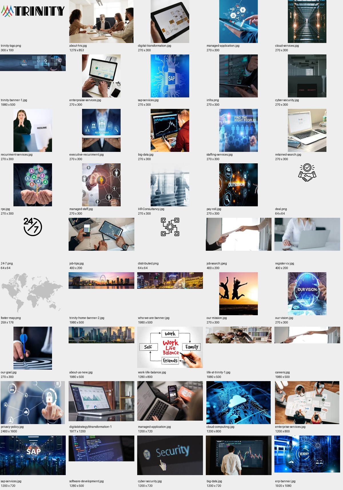

# Asset register

Publicly served same-origin files were downloaded with original bytes and directory paths. Query strings are retained in source URLs in [manifest.json](assets/manifest.json); local paths omit query strings. Multiple URLs can resolve to the same file. A successful download establishes availability, not ownership or a license to deploy the asset.

Site photos, raster icons, logos, favicons and the extracted wave are reference copies. Their rights are not stated; they need permission or replacement before TwinLink production use. The original logo and favicon family depict Trinity and need TwinLink branding regardless of technical availability.

## Images and metadata

| File | Intrinsic size | Usage | Reuse status |
| --- | --- | --- | --- |
| [trinity-logo.png](assets/originals/images/logo/trinity-logo.png) | 300 × 100 | Shared across all 15 routes | Permission or replacement needed |
| [about-hrs.jpg](assets/originals/images/about-hrs.jpg) | 1279 × 853 | /, /about | Permission or replacement needed |
| [digital-transformation.jpg](assets/originals/images/tech-services/digital-transformation.jpg) | 270 × 300 | / | Permission or replacement needed |
| [managed-application.jpg](assets/originals/images/tech-services/managed-application.jpg) | 270 × 300 | / | Permission or replacement needed |
| [cloud-services.jpg](assets/originals/images/tech-services/cloud-services.jpg) | 270 × 300 | / | Permission or replacement needed |
| [trinity-banner-1.jpg](assets/originals/images/banner-images/trinity-banner-1.jpg) | 1980 × 500 | / | Permission or replacement needed |
| [enterpraise-services.jpg](assets/originals/images/tech-services/enterpraise-services.jpg) | 270 × 300 | / | Permission or replacement needed |
| [sap-services.jpg](assets/originals/images/tech-services/sap-services.jpg) | 270 × 300 | / | Permission or replacement needed |
| [infra.png](assets/originals/images/tech-services/infra.png) | 270 × 300 | / | Permission or replacement needed |
| [cyber-security.jpg](assets/originals/images/tech-services/cyber-security.jpg) | 270 × 300 | / | Permission or replacement needed |
| [recuriment-services.jpg](assets/originals/images/hr-services/recuriment-services.jpg) | 270 × 300 | / | Permission or replacement needed |
| [executive-recuriment.jpg](assets/originals/images/hr-services/executive-recuriment.jpg) | 270 × 300 | / | Permission or replacement needed |
| [big-data.jpg](assets/originals/images/tech-services/big-data.jpg) | 270 × 300 | / | Permission or replacement needed |
| [staffing-services.jpg](assets/originals/images/hr-services/staffing-services.jpg) | 270 × 300 | / | Permission or replacement needed |
| [retained-search.jpg](assets/originals/images/hr-services/retained-search.jpg) | 270 × 300 | / | Permission or replacement needed |
| [rpo.jpg](assets/originals/images/hr-services/rpo.jpg) | 270 × 300 | / | Permission or replacement needed |
| [managed-staff.jpg](assets/originals/images/hr-services/managed-staff.jpg) | 270 × 300 | / | Permission or replacement needed |
| [HR-Consultancy.jpg](assets/originals/images/hr-services/HR-Consultancy.jpg) | 270 × 300 | / | Permission or replacement needed |
| [pay-roll.jpg](assets/originals/images/hr-services/pay-roll.jpg) | 270 × 300 | / | Permission or replacement needed |
| [deal.png](assets/originals/images/icons/deal.png) | 64 × 64 | / | Permission or replacement needed |
| [24-7.png](assets/originals/images/icons/24-7.png) | 64 × 64 | / | Permission or replacement needed |
| [job-tips.jpg](assets/originals/images/hrs-values/job-tips.jpg) | 400 × 200 | / | Permission or replacement needed |
| [distributed.png](assets/originals/images/icons/distributed.png) | 64 × 64 | / | Permission or replacement needed |
| [job-search.jpeg](assets/originals/images/hrs-values/job-search.jpeg) | 400 × 200 | / | Permission or replacement needed |
| [register-cv.jpg](assets/originals/images/hrs-values/register-cv.jpg) | 400 × 200 | / | Permission or replacement needed |
| [footer-map.png](assets/originals/images/footer-map.png) | 259 × 176 | Shared across all 15 routes | Permission or replacement needed |
| [trinity-home-banner-2.jpg](assets/originals/images/banner-images/trinity-home-banner-2.jpg) | 1980 × 500 | / | Permission or replacement needed |
| [who-we-are-banner.jpg](assets/originals/images/banner-images/who-we-are-banner.jpg) | 1980 × 500 | / | Permission or replacement needed |
| [our-mission.jpg](assets/originals/images/hrs-values/our-mission.jpg) | 270 × 300 | /about | Permission or replacement needed |
| [our-vision.jpg](assets/originals/images/hrs-values/our-vision.jpg) | 270 × 300 | /about | Permission or replacement needed |
| [our-goal.jpg](assets/originals/images/hrs-values/our-goal.jpg) | 270 × 300 | /about | Permission or replacement needed |
| [about-us-new.jpg](assets/originals/images/banner-images/about-us-new.jpg) | 1980 × 500 | /about | Permission or replacement needed |
| [work-life-balance.jpg](assets/originals/images/work-life-balance.jpg) | 1280 × 800 | /life-at-trinity | Permission or replacement needed |
| [life-at-trinity-1.jpg](assets/originals/images/banner-images/life-at-trinity-1.jpg) | 1980 × 500 | /life-at-trinity | Permission or replacement needed |
| [careers.jpg](assets/originals/images/banner-images/careers.jpg) | 1980 × 500 | /carrer | Permission or replacement needed |
| [privacy-policy.jpg](assets/originals/images/banner-images/privacy-policy.jpg) | 2400 × 1600 | /privacy-policy | Permission or replacement needed |
| [digitalstrategy&transformation-1.jpg](assets/originals/images/digitalstrategy&transformation-1.jpg) | 1977 × 1200 | /digitalstrategy&transformation | Permission or replacement needed |
| [managed-application.jpg](assets/originals/images/managed-application.jpg) | 1200 × 720 | /managed-application | Permission or replacement needed |
| [cloud-computing.jpg](assets/originals/images/cloud-computing.jpg) | 1200 × 800 | /cloud-services-solutions-singapore | Permission or replacement needed |
| [enterprise-services.jpg](assets/originals/images/enterprise-services.jpg) | 1200 × 800 | /enterprise-services | Permission or replacement needed |
| [sap-services.jpg](assets/originals/images/sap-services.jpg) | 1200 × 720 | /sap-services | Permission or replacement needed |
| [software-development.jpg](assets/originals/images/software-development.jpg) | 1280 × 500 | /it-software-solutions | Permission or replacement needed |
| [cyber-security.jpg](assets/originals/images/cyber-security.jpg) | 1200 × 720 | /cyber-security | Permission or replacement needed |
| [big-data.jpg](assets/originals/images/big-data.jpg) | 1200 × 720 | /big-data-&-Analytics | Permission or replacement needed |
| [erp-banner.jpg](assets/originals/images/banner-images/erp-banner.jpg) | 1920 × 1080 | /erp | Permission or replacement needed |
| [apple-icon-57x57.png](assets/originals/images/favicon/apple-icon-57x57.png) | 57 × 57 | homepage head | Permission or replacement needed |
| [apple-icon-60x60.png](assets/originals/images/favicon/apple-icon-60x60.png) | 60 × 60 | homepage head | Permission or replacement needed |
| [apple-icon-72x72.png](assets/originals/images/favicon/apple-icon-72x72.png) | 72 × 72 | homepage head | Permission or replacement needed |
| [apple-icon-76x76.png](assets/originals/images/favicon/apple-icon-76x76.png) | 76 × 76 | homepage head | Permission or replacement needed |
| [apple-icon-114x114.png](assets/originals/images/favicon/apple-icon-114x114.png) | 114 × 114 | homepage head | Permission or replacement needed |
| [apple-icon-120x120.png](assets/originals/images/favicon/apple-icon-120x120.png) | 120 × 120 | homepage head | Permission or replacement needed |
| [apple-icon-144x144.png](assets/originals/images/favicon/apple-icon-144x144.png) | 144 × 144 | homepage head | Permission or replacement needed |
| [apple-icon-152x152.png](assets/originals/images/favicon/apple-icon-152x152.png) | 152 × 152 | homepage head | Permission or replacement needed |
| [apple-icon-180x180.png](assets/originals/images/favicon/apple-icon-180x180.png) | 180 × 180 | homepage head | Permission or replacement needed |
| [android-icon-192x192.png](assets/originals/images/favicon/android-icon-192x192.png) | 192 × 192 | homepage head | Permission or replacement needed |
| [favicon-32x32.png](assets/originals/images/favicon/favicon-32x32.png) | 32 × 32 | homepage head | Permission or replacement needed |
| [favicon-96x96.png](assets/originals/images/favicon/favicon-96x96.png) | 96 × 96 | homepage head | Permission or replacement needed |
| [favicon-16x16.png](assets/originals/images/favicon/favicon-16x16.png) | 16 × 16 | homepage head | Permission or replacement needed |

## Sources, fonts and libraries

The full manifest includes every source URL, local path, response status, MIME type where captured, byte length, SHA-256, usage and reuse note. Binary icon-font files are included in their source directories; they are not Open Sans/Roboto/Poppins text fonts.

| Library | Observed evidence | Reuse assessment |
| --- | --- | --- |
| Bootstrap 5.2.1 | Version and MIT notice in CSS/JS headers; [license](assets/licenses/bootstrap.txt) | Reusable under MIT with notices; no need to introduce this dependency into TwinLink merely to match a grid. |
| Animate.css 4.1.1 | Version/MIT source notice; [license](assets/licenses/animate-css.txt) | Reusable under MIT with notices. |
| Bootstrap Icons | `bi-*` CSS and WOFF/WOFF2 downloaded; [upstream license](assets/licenses/bootstrap-icons.txt) | MIT upstream; bundle version not declared. Verify provenance/version when integrating. |
| Boxicons | `bx-*`, `bxl-*`; EOT/WOFF2/WOFF/TTF/SVG downloaded; [upstream license](assets/licenses/boxicons.txt) | MIT in fetched upstream license. Bundle version not declared; verify version/provenance when integrating. |
| Remix Icon 2.5.0 | Apache 2.0 stated in CSS header; font formats downloaded | Loaded globally, but no `ri-*` icon observed. [Apache license saved](assets/licenses/remixicon.txt); retain applicable license/notice if later used. |
| AOS | Downloaded CSS/JS and runtime settings | Used for scroll reveals; bundled version/license not declared in its minified header. Verify upstream license/version or implement equivalent behavior. |
| Swiper 8.3.2 | MIT notice in source | Loaded globally; portfolio slider configuration exists but no matching visible slider found on these pages. Do not treat as a required site feature. |
| GLightbox | Downloaded CSS/JS | Loaded globally; no video/lightbox content discovered in sampled pages. Version/license requires verification before reuse. |
| Waypoints 4.0.1 | MIT notice in source header | Globally loaded template dependency; no proven required interaction in scope. |
| Isotope 3.0.6 | GPLv3 / commercial notice in source header | Not cleared for incorporation into TwinLink; omit or replace unless a compatible license is deliberately selected. |
| Site CSS / main.js | Original local copies with hashes | Inspect only; not applied to TwinLink. No site-code reuse license stated. |

## Inaccessible or replacement assets

| Asset or dependency | Status | Replacement / next action |
| --- | --- | --- |
| Root tile/manifest icon URLs | Seven HTTP 404s: `/ms-icon-144x144.png` and root Android icon paths in six sizes | Replace favicon/manifest set with valid TwinLink-owned files; exact failed URLs in manifest. |
| Open Sans, Roboto, Poppins Google stylesheet and text-font binaries | Stylesheet request blocked (`ERR_TUNNEL_CONNECTION_FAILED`); font binaries were not obtainable through it | Later obtain official licensed packages and their license files through a permitted source, or choose a deliberate fallback. Do not present current fallback screenshots as font-exact. |
| Google Maps embeds (4 office maps) | Google host blocked by environment; no map tiles copied | Use licensed embeds when allowed, or address cards with external map links. Do not extract/rehost Google map imagery. |
| jQuery 1.9.1 hosted at ajax.googleapis.com | Blocked; no original saved | Preserve TwinLink's existing form behavior. No reason to copy the reference's old jQuery submission code. |
| Trinity logo + all favicons | Downloaded for reference; depicts another company | Replace with TwinLink-owned branding. |
| Stock photos, service cards, value images, PNG icons, footer map | Downloaded; no image-use license discovered | Obtain permission / licensed originals, or use replacements matching composition and aspect ratio. |
| Inline white service wave | SVG extracted from live DOM, separately marked as an extraction | Permission or original replacement path before production use. |
| Videos | No video/audio/source elements, video iframe providers or media resources discovered across 15 routes | No replacement required for this inspected scope; do not invent a video hero. |
| Unused vendor libraries | Saved as source evidence | Keep out of app runtime; use only if an approved interaction actually needs them. |

This register does not authorize a production asset swap. All saved reference material remains under `docs/checkpoint-2/`, outside Next.js `public/` and application imports.
