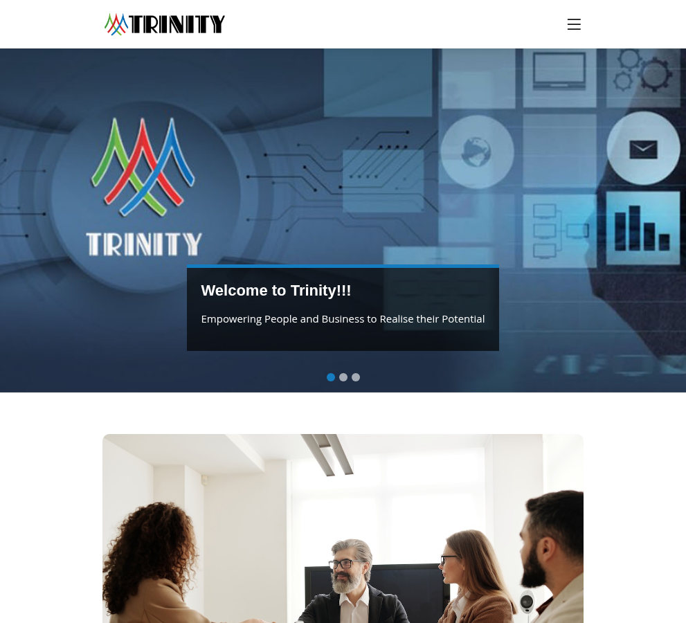
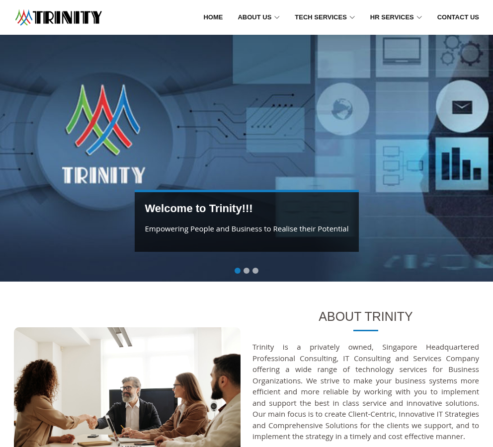
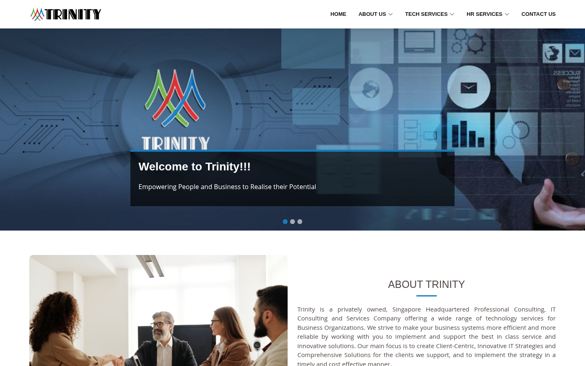

# Checkpoint 2 — Trinity visual system and assets

**Status: documented for approval. Checkpoint 3 has not started.**

Reference: https://www.trinityconsulting.asia/

Based on the approved [checkpoint 1 inventory](../checkpoint-1/README.md), baseline commit `37349d6f9bd6cc870869a872917d0b48ece5c859`. Captured November 4, 2026, America/Chicago (November 5 UTC). This checkpoint adds only documentation, evidence and isolated reference assets. TwinLink application logic is preserved.

## Deliverables and evidence

- [Asset register and replacement list](ASSETS.md): images, icons, text fonts, video findings, vendor licenses and production-use decisions.
- [Asset manifest](assets/manifest.json): 108 URL/extraction entries; 95 saved entries representing **94 distinct files**, seven HTTP 404s and six external resources blocked by this environment. Saved entries include original resources, five upstream license texts and one separately marked SVG extraction. All saved files have byte lengths and SHA-256 hashes.
- [Reference tokens](reference-tokens.json): descriptive JSON, not configuration imported by the application.
- [Computed measurements](evidence/visual-measurements.json): all 15 content routes at 1440 × 900 and 390 × 844; 30 records of typography, colors, spacing, backgrounds, image dimensions, icons, motion and media.
- [Breakpoint probes](evidence/responsive-boundaries.json): homepage and Managed Application at 15 widths each, from 375 to 1440px; no horizontal overflow in those probes.
- [Verification results](evidence/verification.json) and [verification script](scripts/verify.py). Run `python3 docs/checkpoint-2/scripts/verify.py` from the repository root.
- [Runtime checks](evidence/runtime-checks.json): touch-mobile emulation, actual rendered heading font, carousel event timings, reduced-motion styles and inline wave markup.
- [CSS rule index](evidence/css-rule-index.json): source file/line references for site media queries and motion declarations. Original styles are [style.css](assets/originals/css/style.css) and [custom-style.css](assets/originals/css/custom-style.css).

Computed samples come from Chromium with the configured network proxy. Browser tools remain unavailable, so installed Chromium/Playwright supplied fresh captures. The standard page matrix uses viewport resizing; a separate 390 × 844 touch/mobile context confirms the device-width rule and hero height. Physical devices were not tested. Raw measurements include hidden slides and template elements; they are not all visible at once.

Google Fonts, Google-hosted jQuery and Google Maps remain blocked by the environment. No network controls were bypassed, font substituted, map copied or form submitted. “Declared” below means CSS/source intent; “measured” means computed style or runtime observation. Font family declarations alone do not prove which font actually rendered.

## 1. Visual language and palette

The site uses a white fixed header, a large photographic homepage carousel, a restrained blue accent, dark gray text, pale section backgrounds, and a saturated dark-blue footer. Technology detail pages and Contact use a blue title panel with a white SVG wave. About, Life @ Trinity, Careers, Privacy and ERP retain photographic banners. Photography is rectangular with occasional 10px rounding; forms and cards use light shadows rather than thick borders.

| Role | Value | Source / usage |
| --- | --- | --- |
| Main blue | `#157cbf` | Links, rules under headings, service title backgrounds, back-to-top |
| Active carousel indicator | `#157dbf` | Deliberate one-channel difference from main blue |
| Body text | `#4d4643` | Open Sans body and content copy |
| Navigation / copyright | `#111111` | Navigation text; copyright background |
| Footer top | `#00008b` | Main footer background; white text |
| White | `#ffffff` | Header, cards, wave, light surfaces |
| Pale blue | `#f6f9ff` | `.section-bg-blue` |
| Neutral section | `#f7f7f7` | `.section-bg` |
| Caption overlay | `rgba(4,4,4,0.7)` | Hero caption; 5px blue top border |
| Button green | `#1bbd36` | SEND / Send Message, navigation hover, social hover |
| Secondary green | `#79b935` | Enquiry heading and job-prompt link accent |
| Hover green | `#21df41` | Back-to-top hover |
| Error red | `#ff0000` | `.error-forms` |
| Form text / border | `#212529` / `#ced4da` | Bootstrap form controls |
| Privacy title bar | `#376ea8` | Breadcrumb-style title strip |

These are reference-site values, not a proposed new TwinLink brand palette. Brand-logo colors are baked into the original PNG rather than expressed as reusable CSS tokens.

## 2. Typography

The page requests Open Sans, Roboto and Poppins with normal/italic weights 300–700 through Google Fonts. Those downloads are blocked here. The rendered homepage heading was identified through Chromium's platform-font API as **Liberation Sans Bold**, while computed CSS still says `Roboto, sans-serif`. Body and hidden-nav platform-font queries returned no direct glyph records; no claim is made that every element uses that sampled heading fallback.

| Element | Declared family | Desktop size / weight / line-height | Mobile behavior |
| --- | --- | --- | --- |
| Base body | Open Sans, sans-serif | 16px / 400 / 24px | Same |
| Most company/service paragraphs (`.paragraph-style`) | Open Sans | 15px / 400 / 22.5px; justified | Same; narrow justified columns create uneven word spacing |
| Heading defaults | Roboto, sans-serif | Depends on component | Same family |
| Desktop navigation | Roboto | 13px / 600 / 19.5px; uppercase | Hidden at ≤991px; mobile menu links have their own padding |
| Homepage hero heading | Roboto | 28px / 700 / 33.6px | 22px / 700 / 26.4px at ≤992px |
| Homepage hero copy | Open Sans | 16px / 400 / 24px | 15px / 400 / 22.5px at ≤992px |
| About/service section heading | Roboto | 25px / 400 / 20px from custom override | Same; uppercase |
| Unoverridden section heading / Apply Here | Roboto | 32px / 700 / 38.4px | Same |
| Technology card label | Roboto | 16px / 400 / 19.2px | Same |
| Service / Contact blue-banner `h1` | Roboto | 30px / 400 / 36px | **40px / 400 / 48px** at ≤992px, centered; mobile is larger |
| Privacy title | Roboto | 26px / 700 / 31.2px | Same |
| Privacy paragraphs | Open Sans | 16px / 400 / 24px | Same |
| Contact office copy | Open Sans | 14px / 400 / 21px | Same |
| Careers text inputs | Open Sans | 16px / 400 / 24px | Same |
| Contact text inputs | Open Sans | 14px / 400 / 21px | Same |
| Footer list/body | Open Sans | 14px / 400 / 21px | Stacked columns |
| Footer contact copy | Roboto | 14px / 400 / 24px | Same |
| Footer section labels | Roboto | 15px / 500 / 18px; uppercase | Same |

Poppins is requested and appears in unused template rules (skills/team/pricing), but it is not the core family of the inspected public content. Do not apply it globally to reproduce the site.

## 3. Spacing, structure and component geometry

| Component | Recorded geometry |
| --- | --- |
| Grid | Bootstrap 5.2.1; 24px row gutters, 12px each-side column/container padding. At 1440px, container is 1320px with 60px outer margins. At 390px, container fills width with 12px inner sides. |
| Fixed header | 70px measured at both primary widths; 5px vertical padding, logo `max-height:60px`; source PNG 300 × 100 renders up to 180 × 60. Shadow `0 2px 15px rgba(0,0,0,.1)`. |
| Desktop links | `10px 0 10px 30px` padding. Dropdown items `10px 20px`; menus have white surfaces and shadows. |
| Mobile menu | Full-screen fixed overlay; white scrollable list inset top 55px and 15px at left/right/bottom; 10px list vertical padding. Toggle/close icon top/right 15px. Source overlay is `rgba(0,0,0,.9)`; runtime check caught an intermediate transition value, not a different final token. |
| Sections | General `60px 0` padding; `.section-title` adds 30px bottom padding. Many heading blocks have 20px margin-bottom and 20px padding-bottom. |
| Heading underline | 50 × 3px blue pseudo-element, horizontally centered. Custom About heading line-height is only 20px despite 25px text. |
| Homepage hero | `63vh` desktop (567px at 900px height). Background `cover`, center/top positioning. On 320–480px device widths custom rule uses `70vh` (590.8px at 844px height). Height includes content behind the fixed header. |
| Hero caption | 20px padding; 5px blue top rule; positioned in container inset 55px left/right, 60px from bottom. At ≥1024px, 60% of its container; below that it sizes to content. 798px measured desktop versus 280px at 390px viewport. |
| Blue service/Contact panel | `.hero-section.inner-page`: 65vh desktop, min-height 0. Mobile device-width override is 50vh. White wave uses 1920 × 265 SVG viewBox and a bottom offset of −150px (−140px at ≤992px). Hero text uses negative margins/transforms; inspect source rather than treating blank blue space as missing content. |
| Two-column company content | `col-lg-6` halves at ≥992px; stacked below. About image is 1279 × 853, with rounded treatment. |
| Service content/sidebar | `col-lg-9` / `col-lg-3` split at ≥992px; sidebar follows copy on smaller screens. Detail images remain responsive. |
| Service tiles | Original images 270 × 300; custom project blocks add 1.875rem (30px at 16px root) top padding and bottom margin. Project image radius 10px. Label panel shadow `0 3px 7px rgba(0,0,0,.1)`, asymmetric 5px corners. |
| Values/service icon boxes | Standard `.icon-box` padding 60px 20px 70px; image icons include 64 × 64 originals. Job prompt cards use 0 0 70px with 20px horizontal text padding. |
| Forms | Bootstrap text inputs use 6px 12px padding, 1px border and 6px radius. Contact controls have a component override reducing radius to 4px; details in computed records. Contact panel padding 22px, shadow `0 0 30px rgba(214,215,216,.6)`. |
| Submit actions | Green, white text, 10px 24px padding, 4px corner radius; transitions 400ms. |
| Footer | 60px top / 30px bottom padding; four `col-lg-3 col-md-6` columns; each group has 30px bottom margin. Social buttons 36 × 36, 4px radius, 4px right margin, 8px vertical padding. Footer map is a no-repeat background. |
| Back to top | Fixed 40 × 40px, right/bottom 15px, 4px radius; arrow icon 28px; visible after scroll exceeds 100px. |

The site mixes Bootstrap spacing with custom overrides and legacy template rules; it is not a single consistent spacing scale. The JSON includes measured rectangles and resolved padding/margins, while originals preserve the cascade.

## 4. Responsive breakpoints

| Viewport range | Container max-width | Visible layout |
| --- | --- | --- |
| <576px | None (fluid) | Mobile navigation; columns stack |
| 576–767px | 540px | Mobile navigation |
| 768–991px | 720px | Mobile navigation; footer `col-md-6` becomes two columns |
| 992–1199px | 960px | Desktop navigation; `col-lg-*` layout active |
| 1200–1399px | 1140px | Wider desktop grid |
| ≥1400px | 1320px | Largest sampled container |

Boundary checks at 575/576, 767/768, 991/992, 1199/1200 and 1399/1400 confirmed the container changes. Other meaningful conditions:

- Navigation switches at **992px**, but custom hero typography/wave rules use **max-width:992px**, so those rules still apply at exactly 992. This one-pixel overlap is visible in the service boundary screenshots.
- Hero caption width changes to 60% at **min-width:1024px**. Widths 1023/1024 were probed.
- AOS delay overrides apply at **≤768px**. Hero heading/copy resize at **≤992px**.
- Mobile banner overrides use **device width 320–480px**, not simply viewport width. Touch-mobile emulation confirmed `screen.width = 390` and the query matched. This rule also changes `.hero-section.inner-page` to 50vh and shifts text farther up.
- A `max-height:500px` rule sets homepage `#hero` to 120vh; it was source-inspected, not separately visually tested in a short landscape viewport.
- A max-width 1366px rule changes nested dropdown positioning. Most other custom device/orientation media-query blocks are empty placeholders and are not active layout specifications.

## 5. Page families and asset mapping

All 15 checkpoint 1 routes were remeasured. Six `.php` variants were inventoried in checkpoint 1; this visual pass uses their corresponding extensionless content routes.

| Family / routes | Visual assets and layout |
| --- | --- |
| `/` | Three 1980 × 500 banner images; About recruitment photo; eight technology tiles; eight HR tiles; 3 PNG value icons; three 400 × 200 job/CV images; footer-map background. |
| `/about` | `about-us-new.jpg` skyline banner; `about-hrs.jpg`; three Mission/Vision/Goal 270 × 300 cards. |
| `/life-at-trinity` | `life-at-trinity-1.jpg` banner and 1280 × 800 work-life image. |
| `/carrer` | `careers.jpg` photographic banner; white CV form; no vacancy-card imagery. |
| `/privacy-policy` | `privacy-policy.jpg`; blue title strip; long full-width text. |
| `/contact` | Blue wave hero, office blocks, four external maps, feedback panel; shared location/contact glyphs. |
| `/digitalstrategy&transformation` | Blue wave hero; `digitalstrategy&transformation-1.jpg` 1977 × 1200; service sidebar. |
| `/managed-application` | Blue wave hero; `managed-application.jpg` 1200 × 720; sidebar. |
| `/cloud-services-solutions-singapore` | Blue wave hero; `cloud-computing.jpg` 1200 × 800; sidebar. |
| `/enterprise-services` | Blue wave hero; `enterprise-services.jpg` 1200 × 800; sidebar. |
| `/sap-services` | Blue wave hero; `sap-services.jpg` 1200 × 720; sidebar. |
| `/it-software-solutions` | Blue wave hero; `software-development.jpg` 1280 × 500; sidebar. |
| `/cyber-security` | Blue wave hero; `cyber-security.jpg` 1200 × 720; sidebar. |
| `/big-data-&-Analytics` | Blue wave hero; `big-data.jpg` 1200 × 720; sidebar. |
| `/erp` | `erp-banner.jpg` photographic hero; legacy Service Category sidebar. |

Original image filenames, including misspellings such as `enterpraise-services` and `recuriment-services`, are preserved in [the asset register](ASSETS.md). Do not guess corrected source paths. Every saved raster image has its intrinsic dimensions recorded there; the manifest records exact paths and page usage.

### Icons and videos

Bootstrap Icons supplies `bi-chevron-down`, `bi-list`, `bi-arrow-up-short` and `bi-geo-alt`. Boxicons supplies `bx-cog`, `bx-chevron-right`, `bx-phone`, `bx-mail-send` and Facebook/Instagram/Twitter/LinkedIn brand glyphs. Fonts and accompanying CSS were saved; icon semantics and accessible names are not supplied automatically by a glyph. Remix Icon is loaded but no `ri-*` use was observed. The three homepage value icons are PNGs, not font glyphs.

No `<video>`, `<audio>`, `<source>`, video-provider iframe or media resource was discovered across the 15 routes. The four iframes are Google Maps. A globally loaded GLightbox library does not establish that the site contains video. No video download or replacement is needed for this scope.

## 6. Animation and timing

| Effect | Declared / measured timing | Scope and evidence |
| --- | --- | --- |
| Homepage auto-carousel | Declared 5000ms interval; measured 5003.6ms between two slide-start events | Bootstrap `slide.bs.carousel` events; short sample, not a long-run performance guarantee |
| Carousel fade | Source 500ms; observed event durations 508.7ms and 507.0ms | Opacity transition, no horizontal slide transform |
| Hero caption | Animate.css `fadeInUp`, 1000ms, fill mode both | Computed animation; not a separate video |
| Scroll reveals | AOS 1000ms, `ease-in-out`, once true, mirror false, default delay 0 | `main.js` initialization and body runtime attributes |
| Card staggering | Per-element delays 100/200/300ms | `.proj-box`/content data attributes; delay forced to zero at ≤768px |
| Reveals used | `fade-up`, `zoom-in`, `fade-left`, `fade-right` | Per-route element inventory in measurements JSON |
| Header | 500ms | General transition; no claim of 500ms scroll duration |
| Navigation/dropdown/social/card hover | Usually 300ms | Site CSS; image hover scales 1.04 and rotates 1deg; overlay becomes .4 opacity |
| Project label hover | Blue `#0060aa` panel / white linked label; red `#e41e24` icon/title states | Source custom rules; no explicit image-transform duration in that rule, so do not invent one |
| Job-image circle hover | 750ms `circle` animation | White translucent expanding circle pseudo-element |
| Submit buttons / back-to-top appearance | 400ms | CSS transitions; source scroll listener threshold 100px |
| Smooth page scrolling | Browser-native smooth behavior | Duration is distance/browser dependent; no fixed duration claimed |
| Form success message | Handler calls jQuery `fadeOut(5000)` | Source intent only; blocked jQuery prevented execution here; not an observed successful submission |
| Reduced motion | Caption computed as 1ms; carousel computed duration collapses to zero | CSS reduced-motion handling sampled. Autoplay and AOS behavior under reduced motion were not exhaustively tested. |

CSS contains transitions for portfolio/pricing/team components that were not found in this public-page inventory. Those vendor/template rules are not required visual behavior. AOS content can be invisible until scrolled into view; checkpoint 1 full-page evidence triggered reveals before capture.

## 7. Asset availability, permissions and replacements

58 raster image entries have readable dimensions, including favicon variants. The asset preview is in [ASSETS.md](ASSETS.md). The original site resources were retrieved only from public same-origin URLs, with no login, paywall or access restriction bypass. They remain research/reference copies under this documentation directory. Public availability does **not** grant production reuse rights.

Reusable vendor resources have their original notices preserved. Full upstream license texts were obtained for Bootstrap, Animate.css, Bootstrap Icons, Boxicons and Remix Icon; unversioned license sources are identified by URL in the manifest. Site photography, Trinity marks, raster icons and site-specific code have no stated reuse license in the inspected files. Obtain permission or replace them before deployment; no Trinity asset was installed into TwinLink's public directory.

Inaccessible assets and decisions:

- **Seven real 404s:** `/ms-icon-144x144.png` plus six root `/android-icon-{36,48,72,96,144,192}x{36,48,72,96,144,192}.png` URLs referenced by the web manifest (matching size pairs). The manifest uses root-relative paths. The head-linked `/images/favicon/android-icon-192x192.png` works. Replace the entire favicon/manifest family with TwinLink-owned assets and valid paths.
- **Six blocked external URLs:** Google text-font stylesheet, old Google-hosted jQuery and four Google Maps embed URLs. These are environment restrictions, not established source-site outages. No font binaries or map tiles were copied.
- **Branding:** Trinity logo and favicon family must be replaced for TwinLink even if the owner permits reference use.
- **Photography and raster icons:** locally available but reuse rights unverified. Use licensed/owned alternatives if permission is not established.
- **Isotope:** source explicitly states GPLv3/commercial licensing. Do not carry it into the app without a deliberate compatible license decision; its portfolio behavior is outside the discovered scope.
- **Video:** none discovered; no asset gap to fill.

## 8. Review and checkpoint gate

1. **Homepage system — measured:** desktop/mobile styles, imagery, grid and carousel timing recorded.
2. **Subpage families — measured:** all 15 routes represented in the style/asset inventory; representative fresh screenshots saved.
3. **Responsive rules — verified at sampled boundaries:** 30 width/route probes plus a separate touch-mobile check; physical devices and every height/orientation remain outside scope.
4. **Assets — saved with provenance and limits:** originals, dimensions, hashes, licenses, blocked resources and 404s recorded; deployment rights remain explicit per asset.
5. **TwinLink preservation — documentation only:** no application code, routes, authentication, applications, analytics, schema, dependencies or deployed configuration changed.

**Stop for user approval before checkpoint 3.** This document does not authorize an implementation, asset swap or deployment. No app build is needed for this documentation-only checkpoint; verification checks evidence links, JSON, image decoding, hashes, repository scope and the pushed commit.

Representative captures:

Additional fresh screenshots: [About desktop](evidence/about-desktop.png), [About mobile](evidence/about-mobile.png), [Careers desktop](evidence/carrer-desktop.png), [Careers mobile](evidence/carrer-mobile.png), [Contact desktop](evidence/contact-desktop.png), [Contact mobile](evidence/contact-mobile.png), [Privacy desktop](evidence/privacy-policy-desktop.png), [Privacy mobile](evidence/privacy-policy-mobile.png), [ERP desktop](evidence/erp-desktop.png), [ERP mobile](evidence/erp-mobile.png), [Service desktop](evidence/managed-application-desktop.png), [Mobile menu](evidence/mobile-menu.png), [Service at 991px](evidence/service-991.png), [Service at 992px](evidence/service-992.png).
